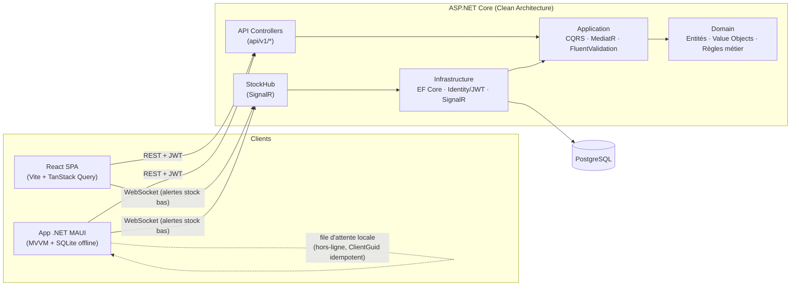

# Système d'inventaire, web et mobile

Application de gestion d'inventaire construite autour d'une seule API REST ASP.NET Core (Clean Architecture). Un frontend React et une application mobile .NET MAUI l'appellent de la même façon. Le mobile ajoute le scan des codes-barres, un mode hors ligne et la synchronisation au retour du réseau.

Projet de portfolio de Julien Barret. Le plan détaillé est dans `docs/Plan_Projet_Inventaire_Web_Mobile.pdf`.

## Stack technique

| Composant | Technologie |
|-----------|-------------|
| API Backend | ASP.NET Core 10 Web API (Clean Architecture) |
| Base de données | PostgreSQL + EF Core |
| Frontend Web | React 18 + TypeScript + Vite + Tailwind + TanStack Query |
| App Mobile | .NET MAUI + MVVM Community Toolkit + SQLite |
| Scan codes | ZXing.Net.MAUI (QR / code-barres) |
| Mode hors-ligne mobile | SQLite (sqlite-net-pcl, pattern Outbox) + service de synchronisation idempotent |
| Auth | ASP.NET Core Identity + JWT + Refresh Tokens |
| Temps réel | SignalR (hub `/hubs/stock`, consommé par React et par le client SignalR mobile) |
| Notifications mobile | Notification OS locale (Plugin.LocalNotification) déclenchée par l'alerte SignalR |
| CQRS / Validation / Mapping | MediatR, FluentValidation, Mapster |
| Tests | xUnit, Moq, FluentAssertions, Testcontainers, Vitest |
| CI/CD | Docker, docker-compose, GitHub Actions |

Le plan visait .NET 8 ; le dépôt utilise le SDK .NET 10 installé localement.

## Architecture du backend

La règle de dépendance va de l'API vers le domaine : API, puis Infrastructure, puis Application, puis Domain. Le `Domain` ne dépend de rien.

```
InventorySystem.Domain          Entités, Value Objects, Domain Events, Exceptions métier
InventorySystem.Application     CQRS (MediatR), DTOs, interfaces, validation (FluentValidation)
InventorySystem.Infrastructure  EF Core (PostgreSQL), repositories, auth, SignalR, export
InventorySystem.Api             Controllers minces, middlewares, composition root
```

### Stock réparti sur plusieurs entrepôts

`Product` est un simple catalogue (SKU, nom, seuil de réapprovisionnement) et ne porte pas de quantité. Le stock est réparti par entrepôt dans l'agrégat `Stock` (`ProductId`, `WarehouseId` et `Quantity`, unique par paire produit-entrepôt). C'est ce qui permet de vrais transferts entre entrepôts : un `StockMovement` de type `Transfer` porte un `WarehouseId` source et un `ToWarehouseId` de destination. Le stock bas (`GetLowStockQuery`) se calcule en additionnant la quantité d'un produit dans tous ses entrepôts.

## Schéma d'architecture



Un mouvement enregistré, depuis le web ou le mobile, passe par `RecordMovementCommand`, qui met à jour `Stock`. Si le seuil de réapprovisionnement est franchi, `IStockNotifier` diffuse une alerte par `StockHub`. Tous les clients connectés la reçoivent en temps réel : le tableau de bord React, et l'application mobile, qui affiche une notification du système.

Hors ligne, le mobile garde les mouvements dans une file SQLite, chacun avec un `ClientGuid` généré sur l'appareil, et les renvoie au retour du réseau. Le serveur ignore sans erreur un mouvement qu'il a déjà appliqué.

## Structure du dépôt

```
InventorySystem/
├── src/
│   ├── Backend/      Solution .NET (4 projets Clean Architecture)
│   ├── Frontend/     App React + TypeScript (Vite), Dockerfile + nginx.conf
│   └── Mobile/       App .NET MAUI + 3 class libs (Domain/Application/Infrastructure)
│                     Infrastructure : Api/, Persistence/ (SQLite offline), Realtime/ (SignalR), Sync/
├── tests/
│   ├── Backend.UnitTests/
│   ├── Backend.IntegrationTests/
│   └── Mobile.UnitTests/    (MovementSyncService, seule logique mobile à branches)
├── docker-compose.yml       postgres + pgadmin + api + frontend
└── .github/workflows/ci.yml backend + frontend + mobile (tests + build Android/Windows)
```

## Démarrage local

### Prérequis

.NET SDK 10, Node.js 20+ et Docker.

### 1. Base de données

```bash
docker compose up -d postgres pgadmin
```

### 2. Backend (API)

Générer et appliquer les migrations EF Core (tables métier et tables Identity) :

```bash
dotnet tool install --global dotnet-ef   # une seule fois si pas déjà installé
dotnet ef migrations add InitialCreate \
  --project src/Backend/InventorySystem.Infrastructure \
  --startup-project src/Backend/InventorySystem.Api

# Après le refactor multi-entrepôt (Warehouse/Supplier/Stock, Product perd Quantity) :
dotnet ef migrations add AddWarehousesSuppliersAndStock \
  --project src/Backend/InventorySystem.Infrastructure \
  --startup-project src/Backend/InventorySystem.Api

dotnet ef database update \
  --project src/Backend/InventorySystem.Infrastructure \
  --startup-project src/Backend/InventorySystem.Api
```

Dans la console du gestionnaire de package (PMC), l'équivalent est `Add-Migration AddWarehousesSuppliersAndStock -StartupProject InventorySystem.Api` puis `Update-Database -StartupProject InventorySystem.Api`, avec `InventorySystem.Infrastructure` choisi comme projet par défaut.

Définir la clé de signature JWT, qui n'est jamais écrite dans `appsettings.json` (voir la section Sécurité) :

```bash
cd src/Backend/InventorySystem.Api
dotnet user-secrets init
dotnet user-secrets set "Jwt:Key" "<chaîne aléatoire d'au moins 32 caractères>"
cd ../../..
```

Créer le premier compte Admin. L'inscription publique attribue toujours le rôle « Employe » : sans cette étape, il faudrait modifier la base à la main pour obtenir un Admin. Elle n'a aucun effet si un Admin existe déjà.

```bash
cd src/Backend/InventorySystem.Api
dotnet user-secrets set "Seed:AdminEmail" "admin@inventory.local"
dotnet user-secrets set "Seed:AdminPassword" "<mot de passe respectant la politique : 8 caractères ou plus, 1 majuscule, 1 chiffre>"
cd ../../..
```

Puis démarrer l'API :

```bash
dotnet build InventorySystem.slnx
dotnet run --project src/Backend/InventorySystem.Api
# Swagger : http://localhost:5244/swagger (ouvert automatiquement, voir launchSettings.json)
```

### 3. Frontend (React)

En développement, avec rechargement à chaud :

```bash
cd src/Frontend
cp .env.example .env
npm install
npm run dev            # http://localhost:3000
```

Le serveur Vite relaie `/api` vers l'API (`http://localhost:5244` par défaut, ou la cible de la variable `API_PROXY_TARGET`). Le front et l'API partagent ainsi la même adresse, comme en production, et le cookie du refresh token circule sans réglage particulier.

En conteneur, comme en CI et en production, sans outil Node :

```bash
docker compose up -d --build frontend   # http://localhost:5173, cible l'API sur :8080
```

`VITE_API_URL` est fixée au build de l'image, car Vite l'insère dans le bundle statique. Elle vient de l'argument de build défini dans `docker-compose.yml` ; pour la changer, il faut reconstruire l'image (`docker compose build frontend`).

### 4. Mobile (MAUI)

L'application mobile couvre l'authentification, la liste des produits, les mouvements, le scan QR et code-barres, le mode hors ligne avec file d'attente SQLite et les notifications de stock bas en temps réel. Lancer l'API avec le profil http (`dotnet run --project src/Backend/InventorySystem.Api --launch-profile http`, port 5244) : le client mobile la trouve sans configuration, hub SignalR compris (`ApiConfig.cs`, `ApiConfig.StockHubUrl`). Le profil http évite, en développement et en démonstration, le certificat auto-signé d'ASP.NET Core, qu'un émulateur ou un simulateur refuse par défaut.

```bash
cd src/Mobile
dotnet build InventoryMobile/InventoryMobile.csproj -f net10.0-android      # ou net10.0-windows10.0.19041.0
```

Sur l'émulateur Android, l'app vise automatiquement `10.0.2.2`, l'adresse de l'hôte vue depuis l'émulateur. Sur un appareil physique ou sous Windows, adapter `ApiConfig.BaseUrl` si l'API tourne sur une autre machine.

ZXing.Net.MAUI ne gère pas la caméra sous Windows (limitation de la bibliothèque) : l'app y affiche un message à la place de l'écran de scan.

## Endpoints principaux

| Endpoint | Accès | Note |
|----------|-------|------|
| `POST /api/v1/auth/register` \| `/login` \| `/refresh` \| `/logout` | Public | Voir la section Sécurité |
| `POST /api/v1/warehouses` | Gestionnaire+ | `GET` ouvert à Employe+ |
| `POST /api/v1/suppliers` | Gestionnaire+ | `GET` ouvert à Employe+ |
| `POST /api/v1/products` | Gestionnaire+ | Crée le produit et son stock initial dans un entrepôt existant |
| `GET /api/v1/products/low-stock` | Employe+ | Agrège le stock total par produit |
| `POST /api/v1/movements` | Employe+ | `Type: In \| Out \| Transfer` (transfert = `WarehouseId` source + `ToWarehouseId` destination) |
| `GET /api/v1/stocks/product/{id}` | Employe+ | Répartition du stock par entrepôt |

Pour tester dans Swagger, créer d'abord un entrepôt : un produit exige un `warehouseId` valide pour son stock initial.

## Sécurité

L'authentification repose sur un JWT de courte durée et un refresh token opaque. Chaque utilisation du refresh token le révoque et le remplace (`RefreshTokenCommand`). Un jeton rejoué hors de la fenêtre de grâce révoque toute sa famille, comme une déconnexion.

Côté web, le JavaScript n'a accès à aucun jeton. L'access token reste en mémoire et le refresh token voyage dans un cookie `HttpOnly; Secure; SameSite=Strict` limité à `/api/v1/auth` (`RefreshTokenCookie`). Le front le demande avec l'en-tête `X-Refresh-Token-Transport: cookie`, et au rechargement de la page un `/auth/refresh` sans corps rouvre la session. Un refresh fait par cookie ne renvoie jamais le jeton dans le corps : un script injecté ne peut donc pas l'exfiltrer.

L'application mobile garde ses jetons dans `SecureStorage` et envoie le refresh token dans le corps de `/auth/refresh`. L'API lui répond par le même canal, sans cookie.

Les mots de passe sont hachés par ASP.NET Core Identity. Un compte est verrouillé 15 minutes après 5 tentatives échouées, ce qui freine les attaques par force brute.

Les rôles sont fixes (`Admin`, `Gestionnaire`, `Employe`) et exposés par des policies (`RequireAdmin`, `RequireGestionnaireOrAbove`, `RequireEmployeOrAbove`). Aucun controller ne contient de nom de rôle en dur.

`Jwt:Key` n'est jamais commitée. En local, elle se définit avec `dotnet user-secrets` (voir plus haut) ; en production, par une variable d'environnement ou un coffre-fort. Si la clé manque ou est trop courte, l'API refuse toute requête d'authentification.

Le CORS est limité aux origines listées dans `Cors:AllowedOrigins`.

## Tests

```bash
# Backend, tests unitaires
dotnet test tests/Backend.UnitTests/InventorySystem.Backend.UnitTests.csproj

# Backend, tests d'intégration (Docker requis : Testcontainers PostgreSQL)
dotnet test tests/Backend.IntegrationTests/InventorySystem.Backend.IntegrationTests.csproj

# Mobile, tests unitaires (MovementSyncService, la seule logique mobile à branches ;
# le reste du mobile est de la plomberie MVVM et plateforme)
dotnet test tests/Mobile.UnitTests/InventoryMobile.Mobile.UnitTests.csproj

# Frontend
cd src/Frontend && npm run test
```

## État d'avancement

Les 18 étapes de la feuille de route (chapitre 13 du plan) sont terminées, déploiement compris.

Le backend compte quatre projets en Clean Architecture. Le domaine contient `Product`, `StockMovement`, le value object `Sku`, des events et des exceptions métier. L'application est organisée en CQRS (MediatR) avec un pipeline de validation et des slices `Products`, `Movements`, `Warehouses`, `Suppliers` et `Stocks`. L'infrastructure fournit l'`AppDbContext` PostgreSQL, les repositories et un Unit of Work. L'API compose le tout, gère les exceptions dans un middleware, expose `ProductsController`, `MovementsController`, `WarehousesController`, `SuppliersController`, `StocksController` et `AuthController`, et ouvre Swagger automatiquement en développement.

L'authentification utilise Identity, un JWT et un refresh token avec rotation, et trois rôles (Admin, Gestionnaire, Employe) dont les policies s'appliquent à tous les controllers métier. Le stock est réparti par entrepôt, avec les transferts et l'agrégation du stock bas décrits plus haut.

Les migrations EF Core `InitialCreate`, `AddWarehousesSuppliersAndStock`, `AddStockConcurrencyToken` et `AddStockMovementProductCreatedIndex` sont générées ; elles s'appliquent avec `dotnet ef database update` (voir Démarrage local).

Côté tests, 21 tests unitaires couvrent le domaine (`Product`, `Stock`) et l'application, dont `RecordMovementCommandHandler` et `GetProductBySkuQuery`. Les 30 scénarios d'intégration passent par `WebApplicationFactory` et Testcontainers PostgreSQL : inscription, connexion, refresh et déconnexion, cookie du refresh token, policies de rôles, création d'un produit avec son stock initial, mouvements d'entrée et de sortie, transferts entre entrepôts et stock insuffisant. Le front est testé avec Vitest et React Testing Library.

Le frontend React est organisé par fonctionnalité, avec un client API, TanStack Query et un tableau de bord. Ses messages d'erreur reprennent le détail renvoyé par le backend. Les produits et l'historique des mouvements s'exportent en Excel ou CSV, en entier ou pour un produit (`IExportService`, ClosedXML, CsvHelper, `GET /products/export` et `GET /movements/export`).

Le temps réel passe par SignalR (`StockHub`). Quand une sortie fait passer un produit sous son seuil, `IStockNotifier` diffuse une alerte « Stock bas », une seule fois par franchissement et non à chaque sortie tant que le produit reste bas.

Docker Compose lance PostgreSQL, pgAdmin, l'API et le frontend, ces deux derniers avec leur propre Dockerfile. Le pipeline GitHub Actions couvre le backend, le frontend et le mobile.

L'application mobile a été construite en deux jalons. Le premier couvre l'authentification, la liste des produits et l'enregistrement d'un mouvement en ligne : contrat Refit complet (`IInventoryApi`) calqué sur les controllers, session persistée dans `SecureStorage` avec rafraîchissement anticipé du jeton (`AuthHeaderHandler`), pages Login, Produits et Mouvement, ViewModels MVVM Community Toolkit et navigation Shell.

Le second ajoute trois fonctions. Le scan QR et code-barres (`ScanViewModel`, ZXing.Net.MAUI) cherche le produit par SKU (`GET /products/by-sku/{sku}`) et préremplit le mouvement ; sous Windows, où la caméra n'est pas gérée, un message s'affiche. Le mode hors ligne range les mouvements dans une file SQLite (`LocalMovement`, pattern Outbox, `sqlite-net-pcl`), rendue idempotente par le `ClientGuid`, et les synchronise au retour sur l'écran des produits, avec un indicateur « en attente ». Enfin, un client SignalR mobile (`IStockAlertHubClient`) écoute le même `StockHub` que le tableau de bord React et affiche une notification locale (Plugin.LocalNotification) à chaque alerte de stock bas. Il n'y a pas de FCM ni d'APNs, qui demanderaient un projet Firebase externe : une app complètement fermée n'est donc pas réveillée. Des tests unitaires couvrent `MovementSyncService` (`tests/Mobile.UnitTests`).

La dernière étape, le déploiement, met le front sur Cloudflare Pages et l'API avec PostgreSQL sur un serveur Linux (voir Déploiement).

## Déploiement

Le site est en ligne : [inventorysystem-jbarret.pages.dev](https://inventorysystem-jbarret.pages.dev).

| Élément | Hébergement |
|---|---|
| Frontend React | Cloudflare Pages, reconstruit à chaque push sur `main` |
| Relais `/api/*` | Cloudflare Pages Functions (`src/Frontend/functions/`) |
| API ASP.NET Core et PostgreSQL | Conteneurs Docker sur un serveur Linux, derrière Caddy (HTTPS) |

Le relais transmet les appels `/api/*` à l'API. Le front et l'API partagent ainsi le même domaine, ce qui évite le CORS et garde les cookies de session en première partie. Le projet Pages a besoin de deux variables : `ORIGIN`, l'adresse HTTPS de l'API sur le serveur, et `PROXY_SECRET`, un secret ajouté à chaque requête dans l'en-tête `X-Portfolio-Proxy`. Caddy refuse toute requête qui ne le porte pas.

En production, le front appelle l'API sur la même adresse (`VITE_API_URL=/api/v1`, dans `src/Frontend/.env.production`). La CI (`.github/workflows/ci.yml`) compile et teste, mais ne déploie rien.
